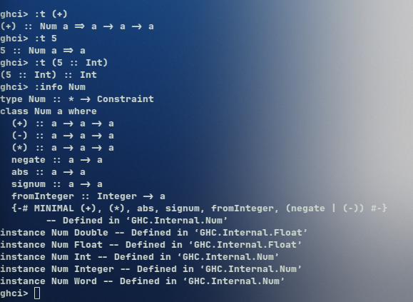

Actividad 1. ¿Cuál es la diferencia entre Num e Int?

R: Int es el tipo de los números enteros que tienen un tamaño fijo, como 5 o -3. A diferencia de Int, Num no es un tipo sino una clase de tipo, o sea un grupo de tipos que comparten las mismas operaciones. Todos los tipos que están en Num se pueden sumar, restar y multiplicar y ahí entran Int, Integer, Float y Double. Por lo tanto, Int es uno de los tipos que pertenecen a Num.

Cuando le pregunto a ghci el tipo de (+), me dice que funciona para cualquier tipo a que esté en Num, y cuando le pregunto el tipo de 5 sin decirle nada me dice que es un Num, porque 5 puede ser Int, Float o cualquier otro tipo numérico. Y si le digo que el 5 es Int, ya regresa solamente Int.

Con :info Num ghci muestra las operaciones de la clase y los tipos que pertenecen a ella, entre ellos Int, Integer, Float y Double.

